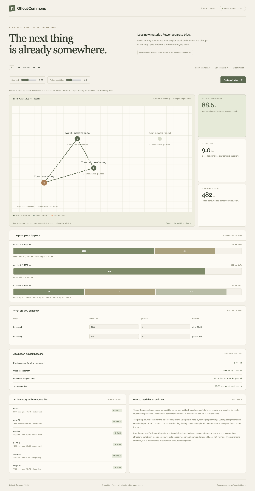

# Offcut Commons

**A cutting plan and a pickup loop for the material that already exists.**

Useful offcuts sit in separate workshops while builders buy new stock and make separate pickup trips. Offcut Commons couples material assignment and pickup routing: it searches for a cutting plan while accounting for the suppliers that plan requires.



## Try it in one command

Python 3.10+ is the only runtime dependency. There are no packages to install, API keys, accounts, build steps, external fonts, or paid services.

```sh
git clone https://github.com/rishitpradhan-gif/offcut-commons.git
cd offcut-commons
python3 server.py
```

Open **http://127.0.0.1:4313**. The server binds to loopback. Use `python3 server.py --port 8000` to choose another port.

Change the cut list, saw kerf, and travel weight. Inspect how selected stock becomes individual parts and how supplier choices change the pickup tour. Import a different local inventory through the scenario editor and export a reproducible plan.

The browser calls the local Python API. Scenarios are held in memory and are not persisted by the server; export files you want to keep. No request is sent to a third-party service. Use a modern browser with Canvas support.

## Use the engine without the UI

```sh
python3 cli.py examples/scenario.json --output plan.json
python3 -m unittest discover -s tests -v
```

Or import the dependency-free engine:

```python
import json
from engine import solve

with open("examples/scenario.json") as source:
    result = solve(json.load(source))
print(result["optimized"])
```

The HTTP API provides `GET /api/sample`, `GET /api/health`, and `POST /api/solve` with a scenario JSON body. Inputs are bounded and invalid scenarios return a JSON error. The server rejects cross-origin mutation requests and serves only the three explicit frontend assets. It is a development server, not a hardened multi-user service.

## What is implemented

- A real, independently callable optimization engine and local HTTP backend.
- A responsive interactive frontend with editable parameters and complete JSON scenarios.
- Scenario import, scenario export, result export, keyboard-accessible inputs, and reduced-motion support where playback is offered.
- Unit tests for constraints, failure cases, and small exact comparisons, plus HTTP tests and a ready-to-enable GitHub Actions template.
- Illustrative examples and committed desktop/mobile screenshots.

## Included example

The included fictional inventory fills 3900 mm of requested cuts using 4400 mm of selected stock, with 482 mm remaining and 18 mm of kerf. The selected suppliers require a 9.00 km closed Euclidean pickup loop. The search completes on this fixture.

## Algorithm

Demand is expanded into individual cuts, sorted longest-first, and assigned to compatible individual stock pieces. The search considers purchase cost, conservative per-cut kerf, leftover length, and the closed pickup tour of the required suppliers.

`objective = purchase_cost + waste_cost_per_meter × leftover_mm / 1000 + travel_cost_per_km × pickup_km`

Assignments are explored with branch-and-bound. Purchase cost is a safe lower bound because the other terms are nonnegative. Equivalent stock candidates are deduplicated only when supplier, cost, stock length, remaining capacity, and used-state agree. Each supplier set has its own exact Held–Karp closed Euclidean tour, cached during the search.

The cutting search stops at 30,000 visited nodes. `search_complete` distinguishes a completed search from a best-so-far plan. The initial incumbent is input-order first fit when feasible. This is an explicit algorithmic baseline, not a claim about normal workshop performance. Exact stock-assignment optimality is only claimed when the search completes (subject to floating-point arithmetic).

Limits: 16 cuts, 20 individual stock pieces, 8 suppliers. All costs use one arbitrary currency unit. Each requested piece consumes one kerf, including the last cut on a stock piece; this is deliberately conservative.

## Scenario contract

- `origin`: workshop `[x,y]` in local Cartesian kilometers.
- `suppliers`: unique ID, optional name, and position in the same coordinate system.
- `stock`: individual piece IDs with supplier, material key, length in mm, and cost.
- `demand`: label, compatible material key, cut length in mm, and integer quantity.
- `kerf_mm`: conservative material loss per requested cut.
- `waste_cost_per_meter`: penalty for unused length in selected stock.
- `travel_cost_per_km`: cost weight of the closed pickup tour.

Unused stock is not charged or counted as consumed. Remaining offcuts may be reusable; the objective’s leftover penalty is a user preference, not a physical waste or carbon claim.

See [examples/scenario.json](examples/scenario.json) for a complete editable input.

## Model and limitations

- Material compatibility is an exact string key. Include grade, species, cross-section, and other relevant constraints in that key. The software does not inspect material quality or structural suitability.
- Only one-dimensional straight lengths are modeled. There is no sheet nesting, grain direction, defect positioning, cut sequencing, or tool configuration.
- Distances are straight-line local kilometers, not road routing or transport emissions.
- Pickup tours ignore vehicle capacity, supplier hours, time windows, stock reservation, and ownership.
- Search may hit its cap; a plan is then best-so-far, not proven globally optimal. Infeasibility before a complete search is not proven infeasibility.
- This is a local planning prototype, not a live inventory network, marketplace, or procurement system. No suppliers have been contacted.

## CI template

The local GitHub credential can publish source but does not have the `workflow` scope. The tested workflow is included as [ci/github-actions-test.yml](ci/github-actions-test.yml). To enable it using a workflow-authorized credential, move it to `.github/workflows/test.yml` and push. CI is not active on this initial publication.

## Architecture

- `engine.py`: pure scenario-to-result function.
- `server.py`: standard-library HTTP server and explicit static asset allowlist.
- `cli.py`: headless JSON-file interface.
- `web/`: browser interface; no build step.
- `examples/`: synthetic, reproducible scenarios.
- `tests/`: engine and API tests.

[Mobile screenshot](docs/mobile.png) · [Contributing](CONTRIBUTING.md) · [Security](SECURITY.md)

## Research context and novelty

This is an original small software implementation and product experiment, not a claim that its underlying research topic is new. It uses established optimization methods. Related work is provided for context; no model weights, proprietary datasets, or research code are required.

- [A Tree-Based Heuristic for the One-Dimensional Cutting Stock Problem Optimization Using Leftovers](https://pmc.ncbi.nlm.nih.gov/articles/PMC10672251/) is related work on reuse-aware cutting stock. This repository uses its own bounded search and adds a small supplier-tour objective; it does not copy that implementation.

## Possible next steps

A practical next step is an opt-in inventory exchange with grade-aware stock records, availability reservations, measured coordinates, and a transport-capacity model. These network features are not implemented in this prototype.

## License

[MIT](LICENSE). Built by Rishit Pradhan. Demo scenarios are fictional and included under the same license.
